# NativeSidebar

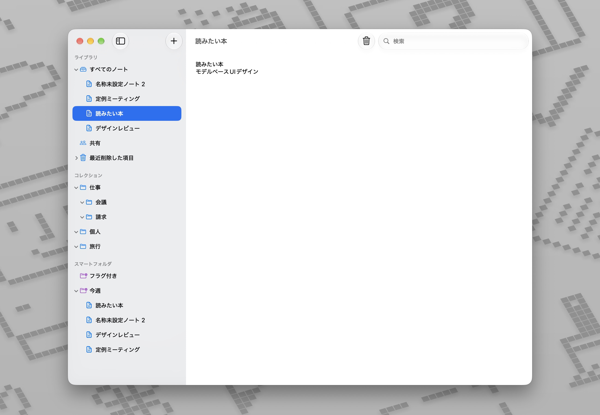

macOSのネイティブアプリで一般的な「サイドバー」パターンをAppKitで実装するためのデモです。ノートアプリ風のデモを通して、サイドバーのデザインと操作の実例を示します。


## 前提技術

- Swift / AppKit
	- SwiftUI、Xib、Storyboardは未使用
- macOS 15以降（ただし、macOS 27でテスト）
- Swift Concurrency
- Swift Package Manager
	- [MainMenuTemplate](https://github.com/usagimaru/MainMenuTemplate)


## デザインと特徴

### 複数選択

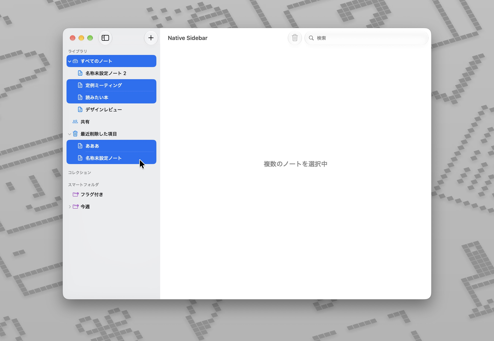

### サイドバー開閉

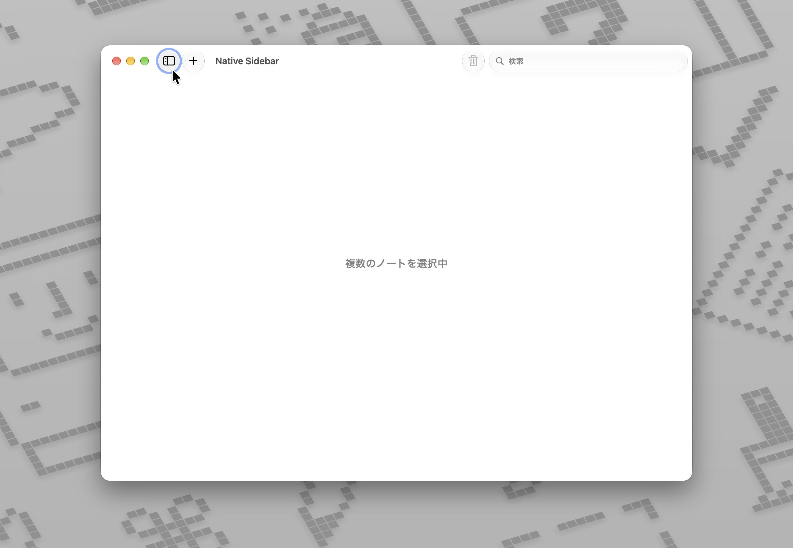

### アクション

**メニューバー**<br/>
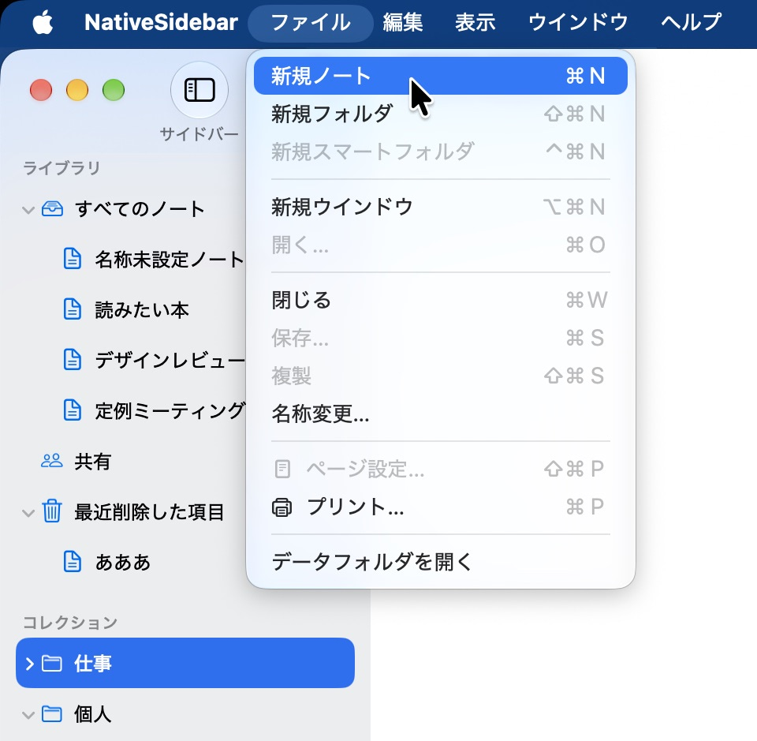

**ツールバー**<br/>
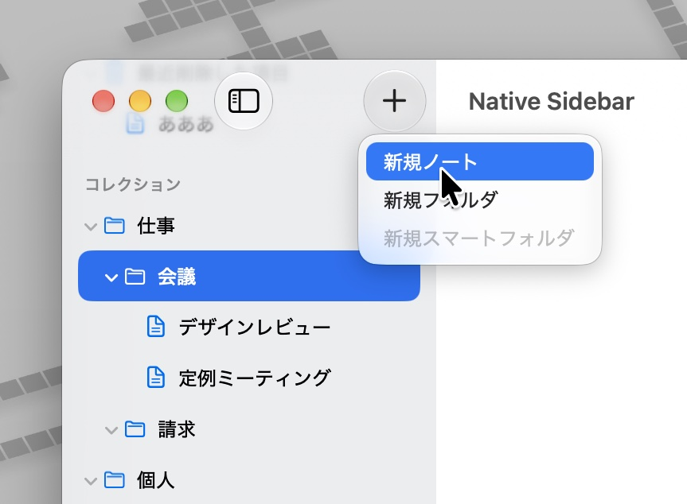

**セクションヘッダー**<br/>
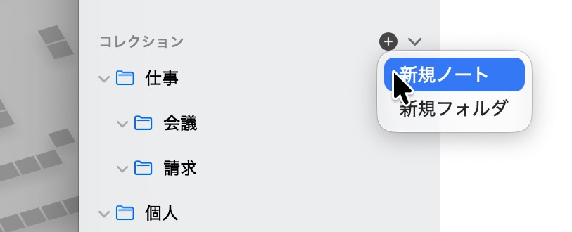

**コンテクストメニュー**<br/>
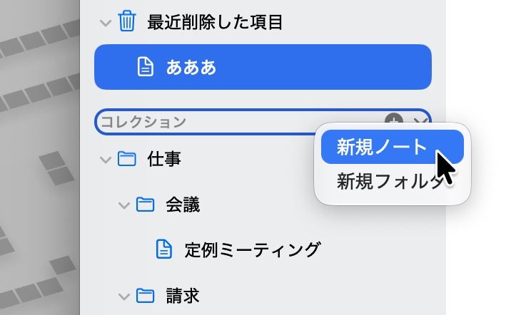

### コンテクストメニューアクション


**名称変更**<br/>
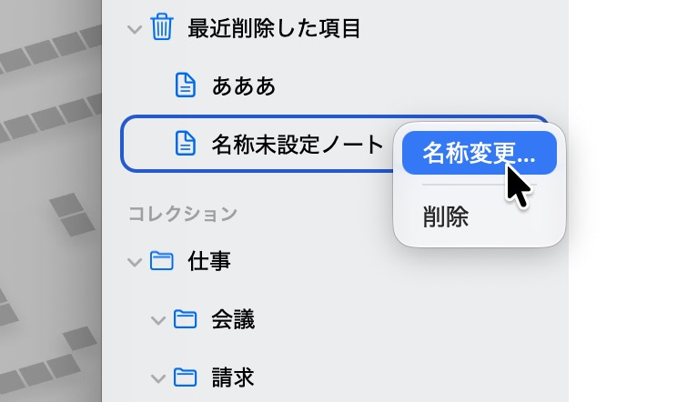

**セクションへの挿入**<br/>


### 名前変更

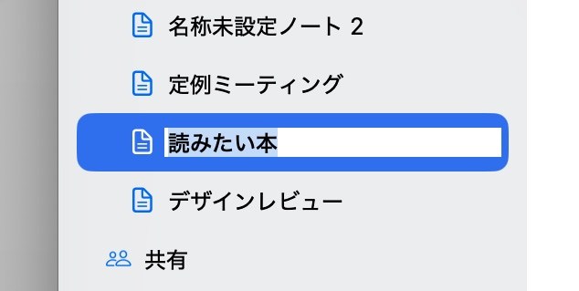


### ドラッグ&ドロップ

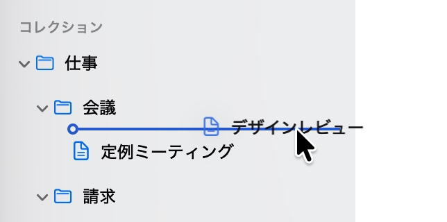
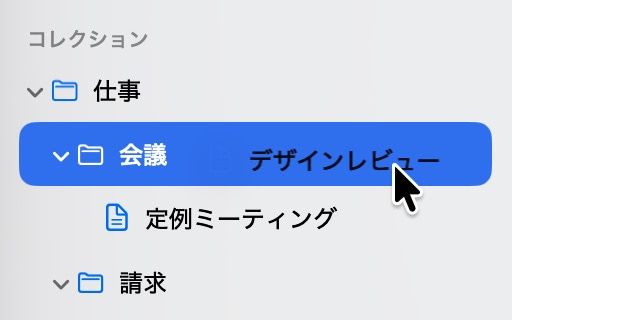


### セルの強調スタイル

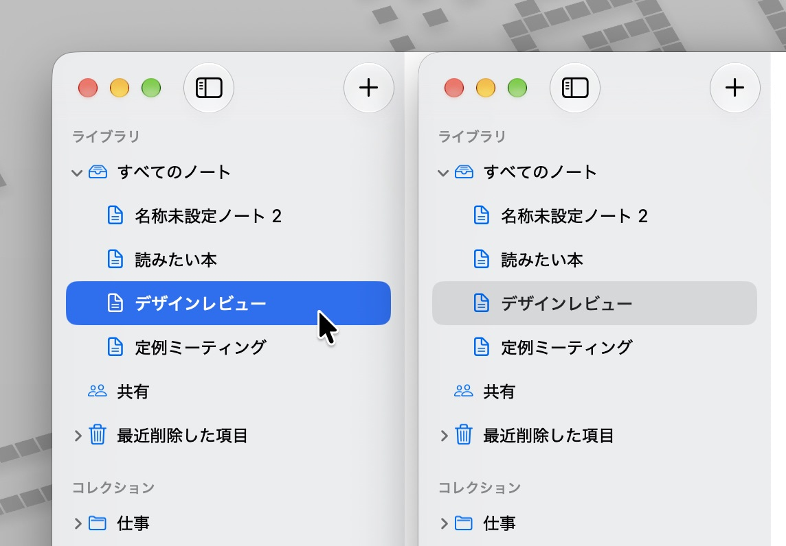

一般スタイル（左：セルがTint Colorで着色）、Fiderスタイル（右、グレー基調で統一）。


### アーキテクチャ

サイドバー自体はNSOutlineViewのソースリストスタイルを使っていますが、アーキテクチャとしては、AppKit依存しないモデル層と、表示を担うビュー層に分けています。

```
SidebarCore/   モデル層（AppKit非依存）
  ├ 要素・ツリー・スナップショット
  ├ スナップショット間の差分導出
  ├ 編集操作と選択状態の管理
  └ 永続化のプロトコル
Sidebar/       ビュー層（AppKit）
  ├ NSOutlineViewへの差分適用とアニメーション
  ├ セル・行ビュー・セクションヘッダー
  ├ 名前編集、コンテクストメニュー、ドラッグ＆ドロップ
  └ メニュー・ツールバーの有効化判定
```

### 差分に基づく更新

モデルの変更をスナップショット間の差分として導出し、`NSOutlineView`へ挿入・削除・移動として適用します。全体でのリロード処理を行わないため、展開状態や選択を保ったままアニメーション付きで更新できます。

### 要素ごとの受け入れ制限

各要素は自身が受け入れる子の種別を持ち、追加・移動・ドロップの可否をこの規則から判定します。セクションによって作成できる項目が変わるといった振る舞いを一箇所で表現できます。

### 永続化の抽象化

モデル層は永続化先をプロトコル経由で扱い、デモではJSONファイルに保存しています。ファイルメニューより実体ファイルをFinderで表示可能です。

### 展開状態の保存（autosave）

サイドバーの展開状態は`NSOutlineView`のautosave（`autosaveExpandedItems`と`autosaveName`）で保存・復元します。データソースで要素の識別子と行を相互に変換し、削除済みの要素は復元時に除外します。初回起動時のみすべてのセクションとフォルダを展開し、以降は保存された状態を復元します。

- 復元はautosave名を設定した時点で実行されるため、要素を読み込んだ後に設定します
- 畳んだ親の下にある要素の展開状態は復元されません（AppKitの挙動）
- 複数ウインドウはautosave名を共有し、最後に変更した状態が保存されます


## デモの特徴

- メモアプリ風の構成（ライブラリ、コレクション、スマートフォルダの各セクション）
- ノート・フォルダ・スマートフォルダの作成、名称変更、削除
- ドラッグ&ドロップによる並べ替えと移動、テキストのドロップによるフォルダ作成
- セクションヘッダー上の追加ボタン
- コンテクストメニュー、メニューバー、ツールバーからの操作とバリデーション
- アイテムの名称変更（1回クリックしてしばらく待つ）
- サイドバーの分割位置に追従するツールバー（`NSTrackingSeparatorToolbarItem`）
- サイドバーの展開状態の保存（`NSOutlineView`のautosave）
- 選択色を控えめにする表示モードの切り替え
	- 一般スタイル（セルがTint Colorで着色）
	- Fiderスタイル（グレー基調で統一）
- マルチウインドウ


### 以下は機能しません（未実装）

- 検索
- 共有
- フラグ（お気に入り）
- スマートフォルダの一部


## メニューバーの構築

macOSアプリ開発では伝統的にMainMenu.xibを使ってメニューバーを構築することが一般的です。AppKitベースのアプリ開発環境において、それは2026年現在でも同様です。しかし、昨今の開発環境ではXibに依存する設計はさまざまな事情からデベロッパーには好まれにくく、かつAppleがXibに変わる代替手段を特に案内していないということもあり、私は簡単なテンプレートライブラリを自作してこの仕組みからの脱却を図っています。


[MainMenuTemplate](https://github.com/usagimaru/MainMenuTemplate) はAppKitベースのアプリ開発において、Macらしいメニューバーのテンプレートをコードから簡単に構築できるライブラリを提供します。英語と日本語のローカライズを含んでいますが、独自にローカライズを拡張することも可能です。

当プロジェクトではMainMenuTemplateを使ってコードベースのメニューバーを実現しています。


## 参考資料

- [Human Interface Guidelines: Sidebars](https://developer.apple.com/design/human-interface-guidelines/sidebars)
- [NSOutlineView](https://developer.apple.com/documentation/appkit/nsoutlineview)
- [NSSplitViewController](https://developer.apple.com/documentation/appkit/nssplitviewcontroller)
- [NSToolbar](https://developer.apple.com/documentation/appkit/nstoolbar)
- [MainMenuTemplate](https://github.com/usagimaru/MainMenuTemplate)


## ライセンス

[MIT License](./LICENSE)
